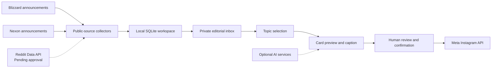

# PostApp

PostApp is a privately hosted Windows web application for discovering Overwatch information and preparing human-reviewed Instagram information carousels.

This repository describes the project for API access review. It does not contain the private running server, account credentials, collected content, or user data. PostApp is an independent fan project and is not affiliated with Reddit, Blizzard Entertainment, Nexon, or Meta.

## How it works

1. Collect public announcements from Blizzard and Nexon, together with approved community sources.
2. Show discovered information in a private editorial inbox.
3. Let the operator select one topic for each Instagram post.
4. Prepare English cards and a caption, with a Korean operator interface.
5. Let the operator replace images, inspect sources, and review the result.
6. Publish to the connected Instagram account only after the operator's final confirmation, using Meta's API.

Automatic collection runs at a random interval of one to three hours. A manual collection button is also available. Discord notifications are optional and require the operator's webhook configuration.

## Requested Reddit API use

Reddit API access is not currently connected. Approval is being requested for this specific use case:

- Read public `r/Overwatch` hot and new listings, up to 100 posts per listing per collection.
- Read post titles, public post text, permalinks, scores, comment counts, publication timestamps, and flairs.
- Display posts from the last seven days that meet a configurable score threshold, initially 100.
- Help the operator discover noteworthy topics and check them against original or official sources.
- Use selected information in externally published Instagram information posts after human review, with source links.

The application does not vote, post, comment, or send messages on Reddit. It does not request private messages or private account data. It does not use Reddit data for model training. No API access or external redistribution is assumed to be approved by this application description.

## AI and media use

Optional AI services may summarize or classify source material and assist with card preparation. If approved Reddit data is used in such a workflow, any third-party processing must remain within the scope permitted by Reddit's approval. PostApp does not independently grant permission to redistribute Reddit users' text or images.

The operator checks source information and media suitability before posting. The application can render structured balance-patch layouts without AI image generation. Skin and hero cards use source imagery or operator-provided images; missing images can be requested from the operator.

## Architecture

The backend uses Python, SQLite, and Pillow. The editor uses HTML, CSS, and JavaScript. The application runs on a private Windows machine. Remote editor access is restricted to a private Tailscale network. Posting images are temporarily made available through a separate HTTPS media endpoint and removed after the upload attempt or expiry.

## Hosting and API review

PostApp is not a public hosted service. Its local editor address is not suitable as an API-review URL. This public repository is the project description; the running application remains private.

The Reddit access request should identify the actual operator and disclose the external Instagram use. The project owner can provide further implementation details if Reddit requests them.
